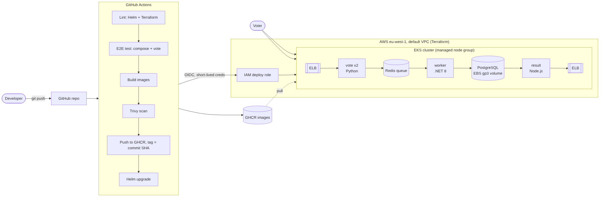
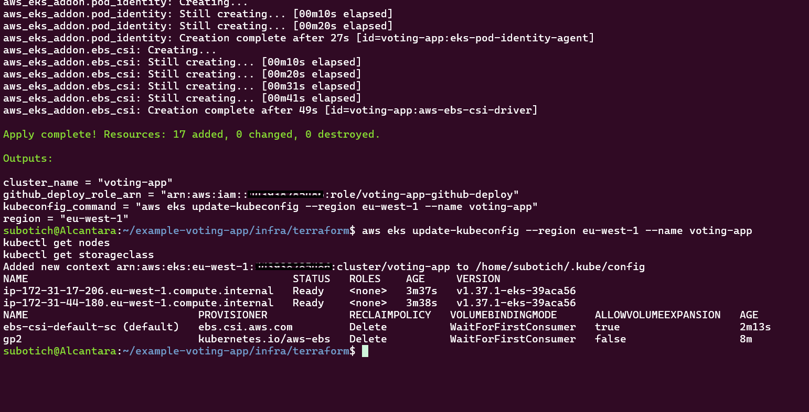
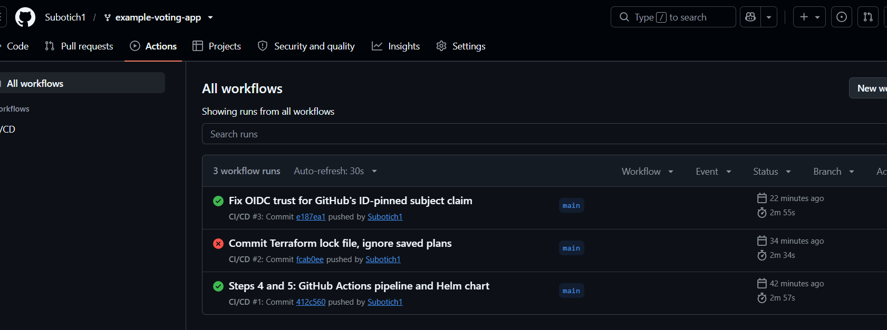
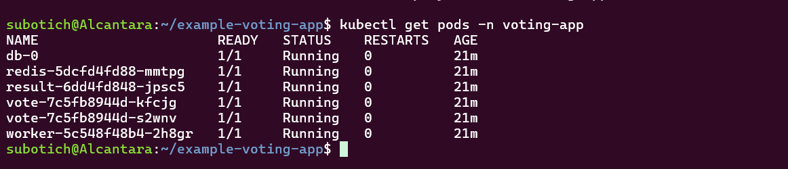
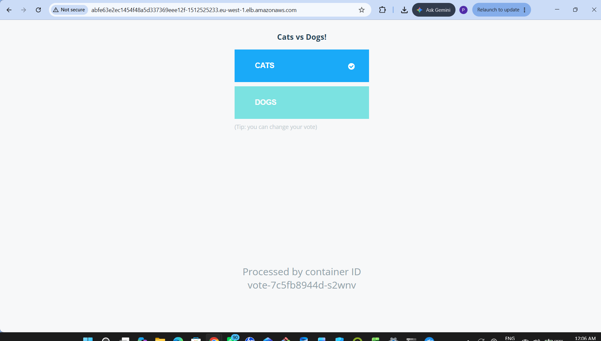
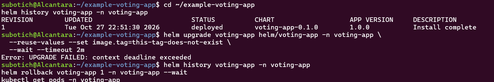
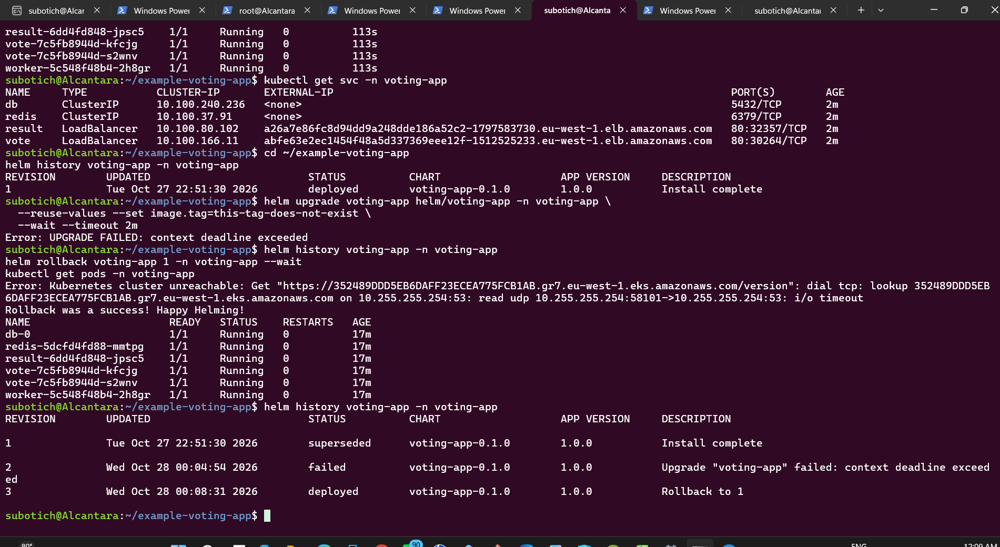
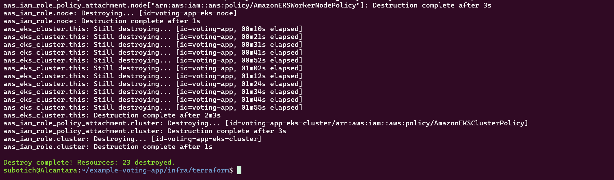
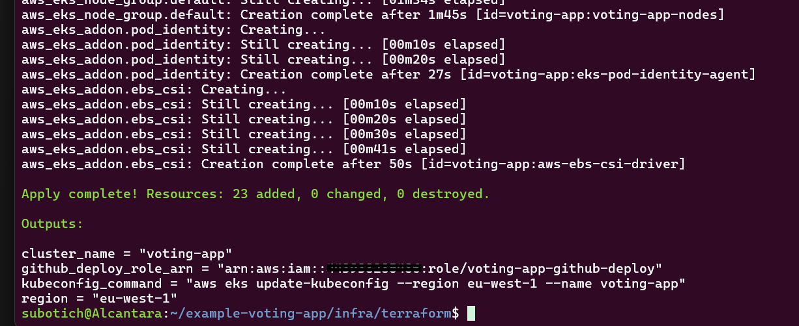

# Voting App on EKS: Ship It

**DevOps Capstone 1** by Peter O. Ajiboye. A five-service app taken from a laptop demo to a hardened, automatically deployed workload on AWS EKS.

One `git push` lints, tests, builds, scans, publishes and deploys. The whole environment is rebuilt from code. No secrets live in Git, and a bad release is rolled back with one command.



## The app

| Service | Language | Role |
|---|---|---|
| `vote` | Python (Flask, gunicorn) | Web page where you cast a vote |
| `redis` | Redis 7.4 | Queue that holds votes |
| `worker` | .NET 8 | Moves votes from Redis into PostgreSQL |
| `db` | PostgreSQL 16 | Stores votes on a persistent EBS volume |
| `result` | Node.js 24 | Web page showing live totals |

Forked from [dockersamples/example-voting-app](https://github.com/dockersamples/example-voting-app).

## What I built

### 1. Run it locally
```bash
cp .env.example .env        # set your own POSTGRES_PASSWORD
docker compose up --build   # vote: localhost:8080, result: localhost:8081
./tests/e2e.sh              # starts the stack, casts a vote, checks it reached PostgreSQL
```

### 2. Containerize safely
| Problem in the original | Fix |
|---|---|
| Every container ran as root | Non-root users with fixed UIDs; Kubernetes enforces `runAsNonRoot` |
| Floating base image tags | Pinned to exact versions (Python 3.12.16, Node 24.22.1, .NET 8.0.33, Redis 7.4.12, Postgres 16.15); Dependabot proposes updates |
| No `.dockerignore` | One per service, keeping `.git`, `.env` and build output out of images |
| Worker on .NET 7 (end of life) | Upgraded to .NET 8 LTS; vulnerable NuGet and npm packages bumped (the result service went from 14 npm advisories, 1 critical, to 0) |
| Database password `postgres` hard-coded in three services | Credentials read from environment variables; Kubernetes Secret in the cluster, git-ignored `.env` locally |
| Test suite needed PhantomJS on Node 8 | Replaced with `tests/e2e.sh`, which CI runs on every push |

### 3. Infrastructure with Terraform
`infra/terraform/` creates, in the account's default VPC (`eu-west-1`):
- EKS cluster using access entries (API authentication mode) instead of the legacy `aws-auth` ConfigMap
- Managed node group (Amazon Linux 2023, x86), sized by variables
- EKS Pod Identity agent and the EBS CSI driver, with a default gp3 StorageClass
- GitHub OIDC provider and a deploy role that only `main` of this repo can assume

```bash
cd infra/terraform
terraform init && terraform apply     # about 15 minutes
aws eks update-kubeconfig --region eu-west-1 --name voting-app
terraform destroy                     # tear everything down
```

Destroying and recreating the cluster from code proves the environment is reproducible.

### 4. CI/CD with GitHub Actions
`.github/workflows/ci-cd.yml`

```
lint (helm lint, terraform fmt/validate) ─┐
e2e test (docker compose + real vote) ────┴─> build x3 ─> Trivy scan ─> push to GHCR ─> helm upgrade on EKS
                                                          (fail on fixable CRITICAL)    (tag = commit SHA)
```
- Pull requests run lint, test, build and scan; only `main` publishes and deploys
- AWS access uses **OIDC**: no AWS keys are stored in GitHub
- Every third-party action is pinned to a commit SHA
- `DEPLOY_ENABLED` repository variable switches deploys off while the cluster is destroyed

### 5. Deploy and roll back with Helm
`helm/voting-app/` is one chart with one values file. Every container has readiness and liveness probes, resource requests and limits, a read-only root filesystem (app services), dropped Linux capabilities and the `RuntimeDefault` seccomp profile.

Rollback demo (full script in [docs/rollback-demo.md](docs/rollback-demo.md)):
```bash
helm upgrade voting-app helm/voting-app -n voting-app --reuse-values \
  --set image.tag=this-tag-does-not-exist --wait --timeout 2m   # fails: ImagePullBackOff
helm rollback voting-app <last-good-revision> -n voting-app --wait
```
Because new pods never pass their readiness probe, the old pods keep serving traffic during the bad release. Users see no downtime.

## Evidence
| | |
|---|---|
|  |  |
| Cluster built from code | One push builds, scans and deploys |
|  |  |
| All pods running, zero restarts | Live vote page on an AWS load balancer |
|  |  |
| Bad release: old pods still serving | Helm history after rollback |
|  |  |
| Environment destroyed with Terraform | Recreated from code with Terraform |

## No secrets in Git
- Database password: GitHub secret, written to a Kubernetes Secret at deploy time
- AWS: OIDC role, no access keys anywhere
- `.env`, `*.tfvars`, Terraform state and saved plans are git-ignored

## Things that broke and how I fixed them
**OIDC role refused GitHub's login** (`Not authorized to perform sts:AssumeRoleWithWebIdentity`).
CloudTrail showed GitHub now sends an ID-pinned subject claim, `repo:owner@OWNER_ID/repo@REPO_ID:ref:refs/heads/main`, while the role trusted only `repo:owner/repo:ref:...`. The trust policy now accepts both, still limited to this repo's `main` branch. The ID-pinned form also protects against someone re-registering a deleted username.

**Cluster unreachable from WSL for a moment.** A transient DNS timeout inside WSL2, not a cluster problem. Retrying worked.

## Cost control
Roughly US$0.25 per hour while running (EKS control plane, two `t3.medium` nodes, two load balancers). The cluster is destroyed after every working session:
```bash
helm uninstall voting-app -n voting-app   # removes the load balancers first
cd infra/terraform && terraform destroy
```

## Repository layout
```
vote/  result/  worker/  seed-data/    application services and Dockerfiles
tests/e2e.sh                           end-to-end smoke test
infra/terraform/                       EKS, node group, add-ons, GitHub OIDC
helm/voting-app/                       Helm chart (one values file)
.github/workflows/ci-cd.yml            pipeline
docs/                                  architecture diagram, rollback runbook, screenshots
```

## Optional next steps
Ingress with a single hostname, remote Terraform state in S3, Argo CD for GitOps, Horizontal Pod Autoscaler.
